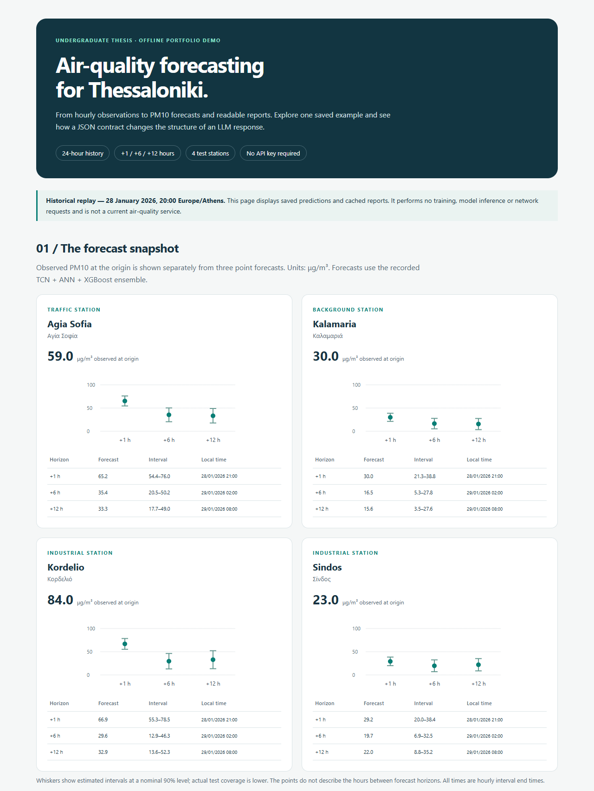
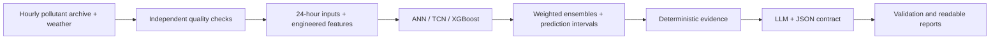
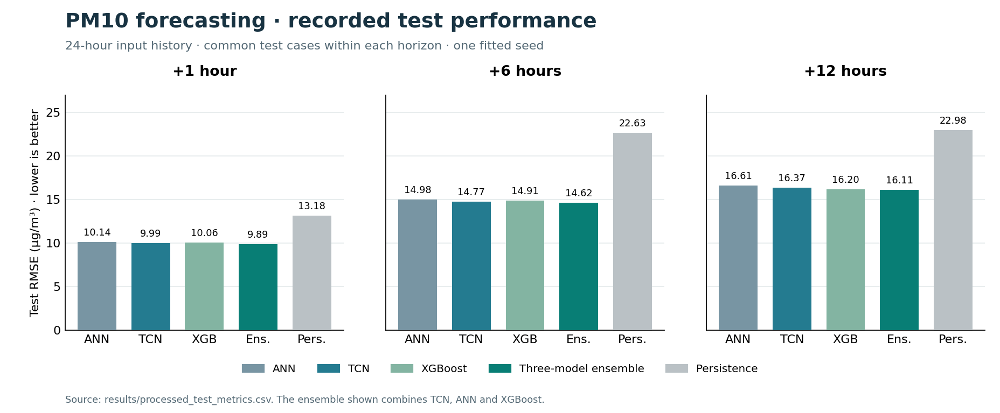

# Thessaloniki Air-Quality Forecasting

**PM10 forecasting with ANN, TCN and XGBoost, followed by structured, readable LLM reports.**

This undergraduate thesis project connects time-series forecasting with a reporting workflow intended for an air-quality application. It uses **24 hours of observations** to predict PM10 **1, 6 and 12 hours ahead**, then supplies measured values and predictions to an LLM through an explicit JSON contract.

The repository includes the current reference pipeline, recorded evaluation results, and a small **offline demo**. The demo replays a real historical example; it does not train models, perform new inference, contact an API or require a key. It is a research prototype, not a deployed monitoring service.

## Try the demo

Requirements: **Python 3.10 or newer**. Tested with Python 3.12. No package installation is needed for the demo.

From the repository folder:

```sh
python demo.py
```

Open **`demo_output/index.html`** in a browser. On Windows, `py demo.py` also works when the Python launcher is installed.

The page contains:

- Saved observations and discrete PM10 forecasts for Agia Sofia, Kalamaria, Kordelio and Sindos.
- Three report tasks: PM10 outlook, outdoor activities and station comparison.
- All 18 original LLM responses, comparing free text with a JSON contract.
- Separately labelled, edited report examples and the complete test-metric table.

The snapshot is **28 January 2026, 20:00 Europe/Athens**. The interface and documentation are in English; the saved reports remain in Greek, the language of the intended application. The HTML is self-contained and works offline.



To verify the examples or choose another output location:

```sh
python demo.py --check
python demo.py --output demo_output/my_demo.html
python -m unittest discover -s tests -v
```

## What the project does



Quality checks use the local observations, without EEA measurement-validity flags. Invalid values and defined placeholder patterns are excluded; statistical anomalies are flagged rather than automatically deleted. Short gaps are forward-filled and remaining missing inputs use training-derived medians. Targets are never imputed.

The processed models receive the same information: 24-hour histories of pollutant/weather variables, observation masks, quality flags, time and station features, and PM10 summaries. ANN and XGBoost use the flattened vector; TCN applies causal, dilated convolutions to the temporal channels and combines the result with static features.

The chronological workflow is **inner training → inner validation → refit on the training period → meta → calibration → test**. Inner validation chooses training settings; meta fits ensemble weights; calibration estimates prediction intervals; test measures final performance. Targets crossing split boundaries are excluded. An additional raw-input experiment provides a paired comparison on the same validation and evaluation cases.

EEA air-quality guidance is used separately in the reporting stage, for available **measured** pollutants. It is not used to validate the training observations or to turn a PM10-only forecast into a forecast of the overall air-quality index.

## Recorded results

Complete test results are in [`results/processed_test_metrics.csv`](results/processed_test_metrics.csv). RMSE and MAE are in μg/m³; R² is dimensionless. These are saved thesis results, not scores computed by the demo.

| Horizon | Model | RMSE | MAE | R² | Test samples |
|---|---|---:|---:|---:|---:|
| +1 h | TCN | 9.99 | 5.71 | 0.785 | 15,219 |
| +1 h | TCN + ANN + XGBoost | 9.89 | 5.62 | 0.789 | 15,219 |
| +1 h | Persistence | 13.18 | 7.27 | 0.626 | 15,219 |
| +6 h | TCN | 14.77 | 9.22 | 0.533 | 15,123 |
| +6 h | TCN + ANN + XGBoost | 14.62 | 9.11 | 0.543 | 15,123 |
| +6 h | Persistence | 22.63 | 14.15 | −0.096 | 15,123 |
| +12 h | TCN | 16.37 | 10.49 | 0.430 | 15,009 |
| +12 h | TCN + ANN + XGBoost | 16.11 | 10.33 | 0.448 | 15,009 |
| +12 h | Persistence | 22.98 | 14.41 | −0.123 | 15,009 |

The three-model ensemble is used for the report example; it is not the lowest-RMSE model at every horizon. At +12 h, TCN + XGBoost achieved RMSE **16.10**.



Across the three base models and three horizons, the processed arm reduced RMSE by **1.1–4.1%** relative to the raw-input arm. This is a combined change in quality control, features, imputation and training-sample selection; the comparison does not isolate the contribution of each step. See [`results/raw_vs_processed.csv`](results/raw_vs_processed.csv).

## What the JSON contract demonstrates

The reporting experiment uses three tasks, two output conditions and three repetitions per condition: **18 original responses**. Both conditions receive the same task and evidence; the contract condition additionally requests schema-conforming JSON, ordered sections and explicit fact references. The stored model identifier is `gemini-2.5-flash`.

All **9 contract responses** matched the requested JSON schema. Free-text responses were not asked to be JSON, so their schema match is **not applicable**, rather than a failed requirement. The contract gives the application predictable fields: `title`, `sections` and `evidence_checks`.

Structure did not guarantee adherence to every instruction: the 180–260-word target was met in 3/3 contract outlook reports, 1/3 activities reports and 0/3 station comparisons. Exact number presence and matching fact references also do not prove that a sentence interprets those numbers correctly.

Original responses are preserved in [`examples/original/`](examples/original/). Edited examples are stored separately in [`examples/reviewed/`](examples/reviewed/), together with review notes. **The editing used AI-assistant assistance; it is not an independent human evaluation.** The experiment scores refer to original responses, not the edited examples.

## Repository map

```text
demo.py                 Offline replay; standard library only
run_pipeline.py         Entry point for the full reference pipeline
src/forecasting/         Quality checks, features, training and evaluation
src/raw_comparison/      Paired raw-input experiment
src/reports/             Evidence, prompts, schemas and Gemini integration
configs/                 Recorded settings, protocols and source hashes
examples/                Saved evidence, original responses and edited examples
results/                 Small CSV summaries from the current experiment
docs/                    Data, reproduction and upload instructions
tools/plot_results.py     Recreate the README figure from saved CSV results
tests/                   Offline demo regression checks
requirements.txt         Dependencies for the full pipeline only
.env.example             Empty API-key template; no credentials included
```

The full observation archive, trained model binaries, generated caches, thesis documents and development history are not bundled. See [data requirements](docs/DATA.md) and [reproduction instructions](docs/REPRODUCIBILITY.md) before attempting training. The full pipeline requires the local archive; it is not needed for the demo.

## Scope and limitations

- This is a retrospective experiment with one fitted seed and a historical test period previously inspected during development. It is not an untouched external validation.
- Large pollution episodes remain difficult. At +6 and +12 h, the report ensemble detected none of the test events above the project's 120 μg/m³ analysis threshold. This hourly threshold is not presented as a legal daily limit.
- Nominal 90% intervals achieved about **85.9%, 81.2% and 78.6%** coverage for the report ensemble at +1, +6 and +12 h. They are not guaranteed probability statements.
- Four stations have test results. The training schema also includes `GR0463A`, which has no final test cases; no test performance is claimed for it.
- Availability of observations and archived weather at forecast time is assumed. The repository does not include a live feed, deployment or user study.
- The 18-response reporting pilot is too small to establish general LLM reliability.

For a first GitHub publication, follow [the upload guide](docs/UPLOAD.md). No repository-wide software license has been selected; see [NOTICE.md](NOTICE.md).
